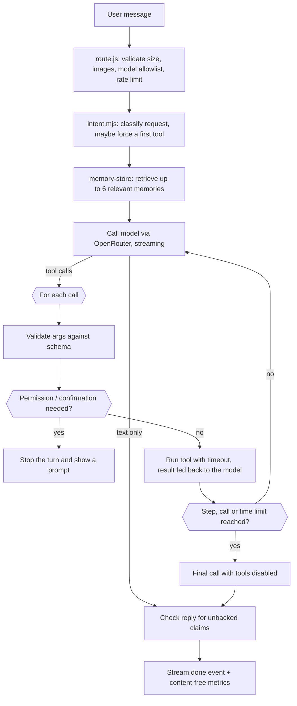

# Nimbus: a desktop-first AI agent

Nimbus is a multi-model AI assistant that **takes actions**: it searches live job boards, the web and your past chats, checks the weather, reads pages and attached files (PDF, Word, images, code), and remembers your preferences, projects and decisions across conversations. It's built with Next.js, React and OpenRouter, and ships as a Windows desktop app (Electron) as well as a hosted demo.

**Live demo:** https://getnimbus.vercel.app/ · **Author:** [John Bass](https://johnbass.dev)

## For reviewers: what to look at

Nimbus is not a chat UI wrapped around one API call. The interesting engineering is on the server:

| What | Where | Why it matters |
|---|---|---|
| Agent loop with hard limits | `lib/nimbus/agent.mjs` | Model ⇄ tool loop capped at 6 steps, 10 tool calls and 90 s per turn, with per-tool timeouts. Limits are enforced in code, not requested in the prompt |
| Tool safety gates | `agent.mjs`, `tools/` | Schema-validated arguments, permission prompts, confirm-before-destructive, and memory writes blocked after untrusted web content enters the turn (stops prompt-injected pages from planting memories) |
| Honest failure reporting | `agent.mjs`, `llm.mjs` | Tool and provider failures go back to the model as errors to report, retryable errors (429/5xx) are retried, and replies claiming an action no tool performed get a visible warning |
| Persistent memory | `lib/nimbus/memory-store.mjs` | Per-user JSON store with atomic writes, per-file write queues, supersede-on-correction, "don't remember X" blocks and secret refusal |
| Request hygiene | `lib/nimbus/request.mjs` | Size limits, image allowlist, model allowlist, per-IP rate limiting. The API key never leaves the server |
| SSRF guard | `lib/nimbus/net.mjs` | Outbound fetches refuse localhost and private/link-local addresses on every redirect hop |
| Desktop packaging | `electron.js` | A bundled Next.js standalone server bound to loopback only, with links opened in the system browser |
| Tests | `tests/`, `scripts/` | 81 unit tests (mocked LLM and HTTP), a smoke test against the built server, and a live eval against real models |

### Desktop app vs. hosted demo

Nimbus is **desktop-first**. The desktop app runs its own local server, so long-term memory lives on your machine (in the app's user-data folder), not on a hosted service. The Vercel demo shows the chat, model switching, tools and streaming, but serverless functions have no persistent disk. Treat long-term memory as a desktop feature: the demo existing doesn't mean every desktop capability works there.

## Features

- **Tool-using agent** — the server runs a model ⇄ tool loop (OpenRouter tool calling) with step, call and time limits. Clear requests are routed straight to the right tool: "job search" runs a job search instead of producing a paragraph about job searching
- **Live job search** — real openings from Remotive, RemoteOK, Jobicy and Arbeitnow (free, no API keys), filtered by keywords, remote, location and salary floor. Salaries are shown only when the employer listed one; nothing is estimated or invented
- **Live research** — `web_search` (Brave or Tavily if you add a key, otherwise DuckDuckGo) and `fetch_url` to read the pages it cites. Searches support a **time range** (past day/week/month/year), **only these sites** / **exclude these sites**, a **region**, and up to **20 results**. Site filters are enforced on the returned results too, and the result says when a provider couldn't apply a filter
- **Weather** — `get_weather` returns the current temperature, feels-like, conditions, humidity, wind and a 3-day forecast from [Open-Meteo](https://open-meteo.com/) (free, no key), with the observation time. Weather questions (typos like "tempature" included) go straight to it, because web-search snippets almost never contain the live reading
- **Files & images** — attach with 📎, paste a screenshot, or drag files onto the message box (up to 5 per message, 10 MB each). Text and code files are read in the browser; PDFs and Word documents are extracted on the server (`/api/extract`, via `unpdf` and `mammoth`); long files are trimmed to 30,000 characters and the reply says so. Images are resized and sent to a vision model; if the selected model can't see images, the free router answers that message with a vision-capable model and a note says so
- **Past-chat search** — `search_chats` finds where something came up in your other conversations ("what did we decide last time about…") and returns the chat title and matching excerpt
- **Permissions** — like ChatGPT and Claude, everyday lookups (web search, reading pages, weather, job search) run automatically by default, while searching your past chats asks first. Anything set to ask shows exactly what it wants to run (e.g. *Search your past chats for "affirm"*) with **Allow once**, **Always allow** or **Deny**. Change any of them in the **🔐 Permissions** panel
- **Persistent memory** — preferences, profile facts, project decisions and open tasks survive new chats and restarts. Only relevant memories go into each prompt, corrections replace old values, "don't remember X" is enforced, and secrets are refused. A **Memory panel** lets you view, edit and delete everything
- **Honest activity trail** — every reply shows the tools that actually ran and the memories it used. Replies that claim an action no tool performed get flagged automatically
- **Live token streaming** — the server reads OpenRouter's SSE stream and re-emits newline-delimited JSON events (tokens plus tool activity) through a `ReadableStream`, so replies render word-by-word
- **Multi-model switching** — swap mid-conversation between free models (the default **Auto (free)** router, Llama 3.3 70B free, Gemma 4 31B free) and low-cost paid ones (DeepSeek V3.2, Llama 3.3 70B, Ministral 8B); the model allowlist is validated server-side
- **Stop & regenerate** — cancel a response mid-stream (`AbortController` wired through to the upstream request) or regenerate the last reply
- **Markdown rendering** — custom zero-dependency renderer with fenced code blocks, copy-to-clipboard, inline code, lists, headings, and links
- **Syntax highlighting** — a small zero-dependency highlighter (`lib/ui/highlight.mjs`) colors code blocks for JS/TS, Python, shell/PowerShell, SQL, CSS, HTML, JSON and C-style languages (C, C++, C#, Java, Go, Rust…)
- **Edit & resend** — edit any message you sent and get a fresh reply from that point, like ChatGPT and Claude
- **Persistent conversations** — chats are auto-titled from your first message and stored locally; search, **rename**, **pin** (pinned chats stay on top) and delete them from the sidebar; newest chats show first. Just start typing on launch: a chat is created automatically, no "New Chat" click needed
- **Responsive** — collapsible sidebar on desktop, off-canvas drawer with backdrop on mobile

## Architecture

```
app/page.jsx ──POST /api/OpenRouter──▶ route.js ──▶ lib/nimbus/agent.mjs
   ▲  NDJSON events (token, tool_start/end,   │      │  intent.mjs      classify, force first tool
   │  memory, notice, confirm, permission,    │      │  permissions.mjs defaults + ask / allow once / always allow
   │  done)                                   │      │  memory-store    retrieve relevant memories
   └──────────────────────────────────────────┼──────┤  llm.mjs         OpenRouter stream + tool calls
                               request.mjs ◀──┘      └─ tools/          search_jobs · web_search · fetch_url · search_chats · get_weather · memory tools
                               limits · rate limit · model allowlist
app/components/MemoryPanel.jsx ──/api/memory──▶ memory-store       view/edit/delete memory (same-origin only)
lib/ui/attachments.mjs ──/api/extract──▶ lib/nimbus/extract.mjs    PDF/Word → text (text files & images handled in the browser)
app/components/PermissionsPanel.jsx                                which lookups run without asking (localStorage)
electron.js ──spawns──▶ .next/standalone/server.js on 127.0.0.1:3000
```

### One turn, step by step



Every step emits NDJSON events, so the UI shows which tools actually ran, which memories were used and any notices, as they happen.

### Where state lives

| Concept | Where it lives |
|---|---|
| Conversation history | Browser localStorage. The current chat is sent with each request; other chats are sent (size-capped) only for replies where past-chat search is allowed |
| Attachments | Stored with the chat in localStorage. File text is sent inside `<attached_file>` tags; images as data URLs (if storage fills up, image data is dropped from the saved copy and the chip says "image not saved") |
| Search permissions | Browser localStorage (`searchPermissions.v2`), sent with each request. Defaults: web, weather and jobs allowed; past chats ask |
| Persistent memory | `NIMBUS_DATA_DIR/memory/<sha256(user token)>.json` on the local server (the desktop app's user-data folder) |
| Current task context | The agent loop's message list for one turn (tool calls and results) |
| Project knowledge | Memories with `category: project/decision` and a `project` name |

**Memory retrieval** is lexical: tokenization, light stemming and a small synonym map ("roles" ↔ "jobs"), with a relevance threshold so unrelated memories stay out of the prompt. It needs no embeddings service and costs nothing per query. Job searches always include saved job preferences, even when the message shares no words with them.

**Identity and privacy.** Each browser gets a random 256-bit token in an HttpOnly, SameSite=Strict cookie. Memory files are named by the token's SHA-256, so the token itself is never stored. There is no parameter anywhere that selects another user's memory. The store refuses API keys, passwords, SSNs and card numbers.

## Failure handling

What happens when something goes wrong:

| Failure | Behavior |
|---|---|
| Model provider returns 429 / 5xx or is unreachable | Retried up to twice with backoff, then a clear error |
| Model route doesn't support tool calling | Detected from the error, retried as plain chat, with a notice in the reply |
| Tool throws or times out | The error goes back to the model with "tell the user honestly, do not fabricate results"; the activity trail shows the failure |
| Model sends malformed or invalid tool arguments | Rejected by the schema validator and returned to the model to correct |
| Model loops on tools | Step, tool-call and wall-clock limits force a final answer with tools disabled; identical repeat calls are served from a per-turn cache |
| Some job boards fail | Results from the others are returned, and the failure is reported |
| Memory store unavailable or file corrupt | The model is told memory is unavailable (it doesn't invent memories); a corrupt file is quarantined, not fatal |
| User hits Stop | `AbortController` cancels the upstream request and any running tool |
| Reply claims "I saved / searched / applied" with no matching tool run | A visible warning is appended to the reply |
| Desktop server fails to start | Error dialog instead of a blank window |

## Security

- **API key stays server-side.** The browser only talks to `/api/OpenRouter`; the key is read from the environment on the server.
- **Constrained requests** (`lib/nimbus/request.mjs`): at most 60 messages, 100,000 chars per message (attached file text included), 200,000 chars total, and 4 images per message (~3 MB each, PNG/JPEG/WebP/GIF data URLs only). Model choice is checked against an allowlist shared with the client (`app/config/models.js`), so a client can't route requests to an arbitrary paid model.
- **Rate limiting:** a per-IP sliding window (20 requests/minute) protects a public deployment from credit-burning abuse.
- **Tool permissions and confirmation:** lookups run only when their permission group is allowed; `forget_all_memories` requires clicking **Confirm**.
- **Prompt-injection containment:** text from web pages, job listings and attached files is marked as untrusted data, kept out of intent routing, and can't trigger memory writes unless your own words asked for one.
- **SSRF protection:** `fetch_url` and the other outbound fetches resolve DNS and refuse loopback, private and link-local addresses, including on redirects.
- **Memory API:** per-user, refuses cross-site writes (on top of a SameSite=Strict cookie), and rejects secrets.
- **Desktop:** the bundled server listens on `127.0.0.1` only (Next's standalone default of `0.0.0.0` would expose the API to the local network). Links open in the system browser and only for `http`, `https` and `mailto`. The window can't be navigated away from the app.

## Engineering trade-offs

Choices that fit a single-user desktop app, and what I'd change at scale:

| Today | Why | At scale |
|---|---|---|
| JSON-file memory store | No native modules to rebuild for Electron, no hosted DB, easy to inspect | A database adapter (Postgres/SQLite) behind the same `memory-store` interface |
| Lexical memory retrieval | Free, fast, deterministic and testable | Embeddings + vector search for fuzzier recall, keeping the threshold and "always include" rules |
| In-memory rate limiter | Correct for one process | A shared store (Redis/Upstash) across instances |
| Chats in browser localStorage | Private and zero-backend | Server-side chat storage with accounts and sync |
| Cookie-based anonymous identity | No sign-up needed | Real authentication, with memory keyed to the account |
| Free-tier search and job APIs | Keeps running costs near zero | Paid search APIs with SLAs, plus a job-data provider |
| OpenRouter key bundled in the personal desktop build | Simplest setup for my own machine | Ask for the key on first launch and store it in the OS keychain before distributing an installer |

## Testing

```bash
npm test               # 81 automated tests, mocked LLM + mocked HTTP
npm run build && node scripts/smoke-server.mjs   # real built server + mock LLM over HTTP
npm run eval           # LIVE: real model, real job boards, real web (uses OPENROUTER_KEY)
npm run metrics        # summarise per-turn metrics logged by the app
```

- `npm test` covers intent routing (with an accuracy figure), tool selection and execution, multistep tasks, malformed tool calls, unknown tools, timeouts, API failures, partial provider outages, step and wall-clock limits, duplicate tool calls, no-tool models, confirmation gating, search permissions (ask / allow once / always allow, per group), search filters for each provider, past-chat search, weather, attachments (including injection via attached files), request validation, rate limiting, the model allowlist, syntax highlighting, prompt-injection memory writes, unbacked-claim detection, SSRF and 10 required memory behaviors. Restart persistence is tested in a separate Node process.
- The smoke test runs the **built** app: NDJSON streaming, cookies, per-user isolation, memory surviving a full server restart, and the memory API (edit, delete, cross-site refusal, secret rejection).
- These tests are **simulated**. Only `npm run eval` proves real end-to-end behavior. It reports task completion, tool-selection accuracy, link grounding (every URL in an answer must come from a tool result), needless clarifying questions and latency, and saves the results to `.nimbus-data/eval/`.

## Configuration

| Env var | Purpose |
|---|---|
| `OPENROUTER_KEY` | Required |
| `BRAVE_API_KEY` / `TAVILY_API_KEY` | Optional. Better web search than the DuckDuckGo fallback (both have free tiers) |
| `NIMBUS_DATA_DIR` | Where memory and metrics are stored. Default `./.nimbus-data`. Electron uses the app's user-data folder |
| `NIMBUS_METRICS=off` | Disable per-turn metrics logging. Metrics never include message content |

## Tech Stack

Next.js · React · Tailwind CSS · OpenRouter API (streaming + tool calling) · Open-Meteo · Node test runner. The only added dependencies are `unpdf` (PDF text) and `mammoth` (Word text).

## Getting Started

1. Clone the repo and install dependencies:

   ```bash
   npm install
   ```

2. Create a `.env.local` with your OpenRouter key:

   ```bash
   OPENROUTER_KEY=sk-or-...
   ```

3. Run the dev server:

   ```bash
   npm run dev
   ```

Open [http://localhost:3000](http://localhost:3000).

## Desktop App (Electron)

`electron.js` wraps the app in a desktop shell. The app relies on server-side API routes, so it can't use a static export. Instead, production builds bundle a self-contained Next.js server (`output: "standalone"` in `next.config.ts`). Electron spawns that server on `127.0.0.1:3000`, stores memory in the app's user-data folder (`NIMBUS_DATA_DIR`) so it survives updates, and points the window at it. It also stops a stale Nimbus server left on the port, and shows an error dialog if the server doesn't start.

```bash
npm run electron        # dev: launches Electron against `next dev`
npm run electron:dist   # prod: builds Next.js + packages with electron-builder
```

The desktop app adds a native right-click menu: **Copy**, **Share** and **Select All** on selected text; **Undo**, **Cut**, **Copy**, **Paste** and **Select All** in the message box; **Open Link in Browser** and **Copy Link** on links. Share uses the native share sheet on macOS; on Windows and Linux it offers **Email…** and **Search the web**, since Electron has no native share sheet there.
